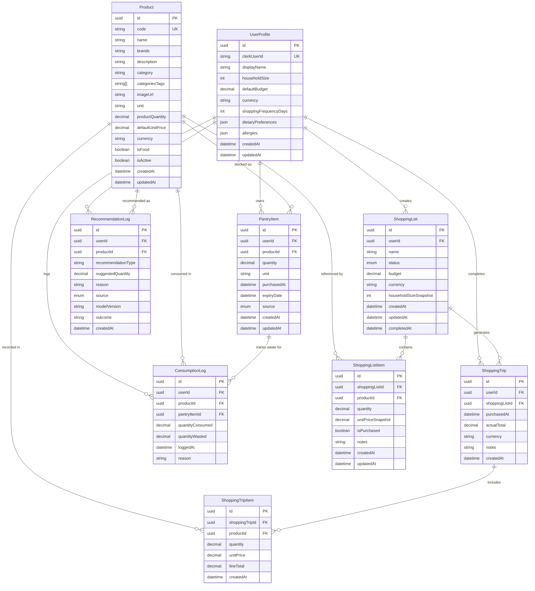

# SmartGrocer — Database Schema Documentation
**System:** SmartGrocer Relational Database Specification  
**Technology:** PostgreSQL 16 & Prisma ORM  
**Location:** `backend/prisma/schema.prisma`  
**Currency Standard:** British Pounds (GBP / £)  
**Status:** In Active Development (Current Working State)  

> [!NOTE]
> **Academic & Development Notice:**  
> This document details the database architecture currently implemented in SmartGrocer. Because the system is under active development, this schema reflects the **current working state** and will continue to evolve as additional machine learning models, receipt scanning, and user features are added.

---

## 1. Visual Entity-Relationship Diagram (ERD)

The diagram below maps all **8 core relational entities**, foreign key relationships, cardinalities, and data attributes:



---

## 2. Enumerated Types (Enums)

### 2.1 `ShoppingListStatus`
Defines the workflow state of a grocery shopping list:
* **`DRAFT`** — The list is being prepared, edited, or planned.
* **`ACTIVE`** — The list is actively being used during an in-store shopping trip.
* **`COMPLETED`** — The shopping trip has finished; purchased items have been processed into pantry stock.
* **`ARCHIVED`** — Historical reference list saved for auditing.

### 2.2 `PantrySource`
Tracks the ingestion channel of a pantry inventory item:
* **`MANUAL`** — Directly added by the user through the app UI.
* **`SHOPPING_LIST`** — Automatically moved into the pantry after checking off a shopping list item.
* **`RECEIPT`** — Ingested via OCR or physical receipt scanning.

### 2.3 `RecommendationSource`
Identifies which prediction engine generated a recommendation:
* **`RULE_BASED`** — Generated using deterministic rules (e.g. category shelf-life thresholds).
* **`ML`** — Generated by the Python FastAPI machine learning microservice (demand models, consumption regressions).

---

## 3. Entity Specifications & Data Dictionary

### 3.1 `UserProfile`
Stores user configuration, household context, and dietary parameters linked to Clerk Authentication.

| Column | Data Type | Constraints | Description |
| :--- | :--- | :--- | :--- |
| `id` | `UUID` | **PK**, Default `gen_random_uuid()` | Internal unique identifier. |
| `clerkUserId` | `String` | **Unique**, Indexed | Identity token from Clerk Auth. |
| `displayName` | `String?` | Nullable | User's preferred display name. |
| `householdSize` | `Int` | Default `1` | Number of household members (used in AI consumption calculations). |
| `defaultBudget` | `Decimal(10,2)?`| Nullable | Target weekly grocery expenditure in GBP (£). |
| `currency` | `String` | Default `"GBP"` | Currency standard. |
| `shoppingFrequencyDays`| `Int?` | Nullable | Average interval between grocery visits (e.g. 7 days). |
| `dietaryPreferences` | `Json?` | Nullable | Array of preferences (e.g. `["Vegetarian", "Gluten-Free"]`). |
| `allergies` | `Json?` | Nullable | Specific food allergens (e.g. `["Peanuts", "Dairy"]`). |
| `createdAt` | `DateTime` | Default `now()` | Timestamp of account registration. |
| `updatedAt` | `DateTime` | Auto-update | Timestamp of profile modification. |

---

### 3.2 `Product`
Master catalogue of UK supermarket goods populated from Open Food Facts.

| Column | Data Type | Constraints | Description |
| :--- | :--- | :--- | :--- |
| `id` | `UUID` | **PK**, Default `gen_random_uuid()` | Unique product identifier. |
| `code` | `String` | **Unique**, Indexed | Standard EAN-13 universal barcode. |
| `name` | `String` | Indexed | Commercial title (e.g. *"British Semi-Skimmed Milk"*). |
| `brands` | `String?` | Nullable | Manufacturer brand (e.g. *"Tesco"*, *"Warburtons"*, *"Lurpak"*). |
| `description` | `String?` | Nullable | Product details or serving instructions. |
| `category` | `String` | Indexed | Primary department (`Dairies`, `Breads`, `Beverages`, etc.). |
| `categoriesTags` | `String[]` | Default `[]` | Raw hierarchical taxonomic tags. |
| `imageUrl` | `String?` | Nullable | CDN URL to high-resolution product photography. |
| `unit` | `String` | Default `"g"` | Measurement unit (`g`, `ml`, `pack`, `piece`). |
| `productQuantity` | `Decimal(10,2)?`| Nullable | Net package weight or volume (e.g. `500.00`). |
| `defaultUnitPrice` | `Decimal(10,2)` | Non-negative | Benchmark shelf price in GBP (£) (e.g. `1.55`). |
| `currency` | `String` | Default `"GBP"` | Currency code. |
| `isFood` | `Boolean` | Default `true` | Distinguishes food products from non-food items. |
| `isActive` | `Boolean` | Default `true` | Soft-deletion flag for discontinued items. |
| `createdAt` | `DateTime` | Default `now()` | Product record creation timestamp. |
| `updatedAt` | `DateTime` | Auto-update | Product record update timestamp. |

---

### 3.3 `ShoppingList`
Represents an active or upcoming shopping trip basket.

| Column | Data Type | Constraints | Description |
| :--- | :--- | :--- | :--- |
| `id` | `UUID` | **PK**, Default `gen_random_uuid()` | Unique shopping list ID. |
| `userId` | `UUID` | **FK** ➔ `UserProfile.id` (Cascade) | List owner. |
| `name` | `String` | Required | Title (e.g. *"Weekly Groceries"*). |
| `status` | `ShoppingListStatus`| Default `DRAFT`, Indexed | Current workflow status. |
| `budget` | `Decimal(10,2)?`| Nullable | User-defined budget limit for this list. |
| `currency` | `String` | Default `"GBP"` | Currency code. |
| `householdSizeSnapshot`| `Int` | Default `1` | Historical household size snapshot when list was formed. |
| `createdAt` | `DateTime` | Default `now()` | List creation date. |
| `updatedAt` | `DateTime` | Auto-update | Last modification date. |
| `completedAt` | `DateTime?`| Nullable | Date trip was completed and finalized. |

---

### 3.4 `ShoppingListItem`
Line items inside a shopping list with quantities and price freeze snapshots.

| Column | Data Type | Constraints | Description |
| :--- | :--- | :--- | :--- |
| `id` | `UUID` | **PK**, Default `gen_random_uuid()` | Unique line item ID. |
| `shoppingListId` | `UUID` | **FK** ➔ `ShoppingList.id` (Cascade) | Associated shopping list. |
| `productId` | `UUID` | **FK** ➔ `Product.id` | Associated product catalogue reference. |
| `quantity` | `Decimal(10,2)` | Default `1.00` | Desired purchase quantity. |
| `unitPriceSnapshot` | `Decimal(10,2)`| Required | Price frozen at the moment item was added to the list. |
| `isPurchased` | `Boolean` | Default `false` | In-store checklist tickbox status. |
| `notes` | `String?` | Nullable | User instructions (e.g. *"Check expiry date"*). |
| `createdAt` | `DateTime` | Default `now()` | Addition date. |
| `updatedAt` | `DateTime` | Auto-update | Modification date. |

---

### 3.5 `PantryItem`
Real-time household inventory tracking remaining stock and expiration countdowns.

| Column | Data Type | Constraints | Description |
| :--- | :--- | :--- | :--- |
| `id` | `UUID` | **PK**, Default `gen_random_uuid()` | Unique inventory ID. |
| `userId` | `UUID` | **FK** ➔ `UserProfile.id` (Cascade) | Pantry owner. |
| `productId` | `UUID` | **FK** ➔ `Product.id` | Associated product catalogue reference. |
| `quantity` | `Decimal(10,2)` | Default `1.00` | Current available quantity. |
| `unit` | `String` | Default `"piece"` | Measurement unit (`piece`, `pack`, `g`, `ml`). |
| `purchasedAt` | `DateTime?`| Default `now()` | Date the item was acquired. |
| `expiryDate` | `DateTime?`| Nullable, Indexed | Calculated or manual expiration date. |
| `source` | `PantrySource` | Default `MANUAL` | Ingestion channel. |
| `createdAt` | `DateTime` | Default `now()` | Entry creation date. |
| `updatedAt` | `DateTime` | Auto-update | Entry modification date. |

---

### 3.6 `ShoppingTrip` & `ShoppingTripItem`
Historical supermarket checkout records used by the AI engine to compute realistic consumption velocities.

#### `ShoppingTrip`
* `id` (`UUID`, PK)
* `userId` (`UUID`, FK ➔ `UserProfile.id`, Cascade)
* `shoppingListId` (`UUID?`, FK ➔ `ShoppingList.id`, SetNull)
* `purchasedAt` (`DateTime`, Default `now()`, Indexed)
* `actualTotal` (`Decimal(10,2)`) — Real total charged at checkout.
* `currency` (`String`, Default `"GBP"`)
* `notes` (`String?`)
* `createdAt` (`DateTime`, Default `now()`)

#### `ShoppingTripItem`
* `id` (`UUID`, PK)
* `shoppingTripId` (`UUID`, FK ➔ `ShoppingTrip.id`, Cascade)
* `productId` (`UUID`, FK ➔ `Product.id`)
* `quantity` (`Decimal(10,2)`)
* `unitPrice` (`Decimal(10,2)`)
* `lineTotal` (`Decimal(10,2)`) — Calculated as `quantity * unitPrice`.
* `createdAt` (`DateTime`, Default `now()`)

---

### 3.7 `ConsumptionLog`
Tracks everyday pantry consumption events and discarded food items for waste risk modeling.

| Column | Data Type | Description |
| :--- | :--- | :--- |
| `id` | `UUID`, PK | Unique consumption log ID. |
| `userId` | `UUID`, FK | User who logged consumption. |
| `productId` | `UUID`, FK | Product consumed or wasted. |
| `pantryItemId` | `UUID?`, FK | Link to pantry item (SetNull if pantry item is deleted). |
| `quantityConsumed` | `Decimal(10,2)` | Amount consumed by household members. |
| `quantityWasted` | `Decimal(10,2)?`| Amount discarded due to spoilage or expiry. |
| `loggedAt` | `DateTime`, Indexed | Event timestamp. |
| `reason` | `String?` | Optional explanation (e.g. *"Spoiled before use"*). |

---

### 3.8 `RecommendationLog`
Telemetry auditing predictions generated by AI models and user actions.

| Column | Data Type | Description |
| :--- | :--- | :--- |
| `id` | `UUID`, PK | Recommendation record ID. |
| `userId` | `UUID`, FK | Target user. |
| `productId` | `UUID`, FK | Suggested product. |
| `recommendationType` | `String` | Type: `REPLENISHMENT`, `WASTE_ALERT`, or `ALTERNATIVE_SWAP`. |
| `suggestedQuantity` | `Decimal(10,2)?`| Predicted quantity. |
| `reason` | `String` | User-facing explanation (e.g. *"Likely to run out in 2 days"*). |
| `source` | `RecommendationSource`| Model type (`RULE_BASED` or `ML`). |
| `modelVersion` | `String?` | ML model version tag (e.g. `"demand-v1.2.0"`). |
| `outcome` | `String?` | User response: `ACCEPTED`, `DISMISSED`, `PURCHASED`. |
| `createdAt` | `DateTime` | Generation timestamp. |

---

## 4. Key Engineering Standards & Relational Integrity

1. **Fixed-Point Financial Math (`Decimal(10, 2)`)**:
   - All currencies, budgets, and physical weights are stored with explicit fixed-point `Decimal(10, 2)` types rather than floating-point numbers (`Float`) to eliminate IEEE 754 precision errors.
2. **Cascading Strategies**:
   - Deleting a `UserProfile` cascades across all associated user records (`ShoppingList`, `PantryItem`, `ShoppingTrip`, `ConsumptionLog`) via `onDelete: Cascade`.
   - Deleting a `ShoppingList` cascades to its `ShoppingListItem` line items.
   - Removing a `Product` is strictly protected to prevent breaking historical consumption and trip records.
3. **Database Indexing Strategy**:
   - High-cardinality search columns are indexed using PostgreSQL B-Trees:
     - `Product(code)` — Barcode lookups ($O(\log N)$).
     - `Product(name)` — Fast catalogue search queries.
     - `Product(category)` — Department filtering.
     - `PantryItem(expiryDate)` — Home screen "Expiring Soon" alert queries.
     - `ShoppingTrip(purchasedAt)` — Historical time-series analytics.

---

## 5. Active Prisma Schema Source Code

```prisma
generator client {
  provider = "prisma-client-js"
}

datasource db {
  provider = "postgresql"
}

enum ShoppingListStatus {
  DRAFT
  ACTIVE
  COMPLETED
  ARCHIVED
}

enum PantrySource {
  MANUAL
  SHOPPING_LIST
  RECEIPT
}

enum RecommendationSource {
  RULE_BASED
  ML
}

model UserProfile {
  id                    String              @id @default(uuid()) @db.Uuid
  clerkUserId           String              @unique
  displayName           String?
  householdSize         Int                 @default(1)
  defaultBudget         Decimal?            @db.Decimal(10, 2)
  currency              String              @default("GBP")
  shoppingFrequencyDays Int?
  dietaryPreferences   Json?
  allergies             Json?
  createdAt             DateTime            @default(now())
  updatedAt             DateTime            @updatedAt

  shoppingLists         ShoppingList[]
  pantryItems           PantryItem[]
  shoppingTrips         ShoppingTrip[]
  consumptionLogs       ConsumptionLog[]
  recommendationLogs    RecommendationLog[]

  @@index([clerkUserId])
}

model Product {
  id                String             @id @default(uuid()) @db.Uuid
  code              String             @unique // EAN-13 barcode
  name              String
  brands            String?
  description       String?
  category          String
  categoriesTags    String[]           @default([])
  imageUrl          String?
  unit              String             @default("g") // g, ml, pack, piece
  productQuantity   Decimal?           @db.Decimal(10, 2)
  defaultUnitPrice  Decimal            @db.Decimal(10, 2)
  currency          String             @default("GBP")
  isFood            Boolean            @default(true)
  isActive          Boolean            @default(true)
  createdAt         DateTime           @default(now())
  updatedAt         DateTime           @updatedAt

  shoppingListItems ShoppingListItem[]
  pantryItems       PantryItem[]
  shoppingTripItems ShoppingTripItem[]
  consumptionLogs   ConsumptionLog[]
  recommendationLogs RecommendationLog[]

  @@index([name])
  @@index([category])
  @@index([code])
}

model ShoppingList {
  id                    String              @id @default(uuid()) @db.Uuid
  userId                String              @db.Uuid
  name                  String
  status                ShoppingListStatus  @default(DRAFT)
  budget                Decimal?            @db.Decimal(10, 2)
  currency              String              @default("GBP")
  householdSizeSnapshot Int                 @default(1)
  createdAt             DateTime            @default(now())
  updatedAt             DateTime            @updatedAt
  completedAt           DateTime?

  user                  UserProfile         @relation(fields: [userId], references: [id], onDelete: Cascade)
  items                 ShoppingListItem[]
  shoppingTrips         ShoppingTrip[]

  @@index([userId])
  @@index([status])
}

model ShoppingListItem {
  id                 String       @id @default(uuid()) @db.Uuid
  shoppingListId     String       @db.Uuid
  productId          String       @db.Uuid
  quantity           Decimal      @default(1) @db.Decimal(10, 2)
  unitPriceSnapshot  Decimal      @db.Decimal(10, 2)
  isPurchased        Boolean      @default(false)
  notes              String?
  createdAt          DateTime     @default(now())
  updatedAt          DateTime     @updatedAt

  shoppingList       ShoppingList @relation(fields: [shoppingListId], references: [id], onDelete: Cascade)
  product            Product      @relation(fields: [productId], references: [id])

  @@index([shoppingListId])
  @@index([productId])
}

model PantryItem {
  id              String            @id @default(uuid()) @db.Uuid
  userId          String            @db.Uuid
  productId       String            @db.Uuid
  quantity        Decimal           @default(1) @db.Decimal(10, 2)
  unit            String            @default("piece")
  purchasedAt     DateTime?         @default(now())
  expiryDate      DateTime?
  source          PantrySource      @default(MANUAL)
  createdAt       DateTime          @default(now())
  updatedAt       DateTime          @updatedAt

  user            UserProfile       @relation(fields: [userId], references: [id], onDelete: Cascade)
  product         Product           @relation(fields: [productId], references: [id])
  consumptionLogs ConsumptionLog[]

  @@index([userId])
  @@index([productId])
  @@index([expiryDate])
}

model ShoppingTrip {
  id              String             @id @default(uuid()) @db.Uuid
  userId          String             @db.Uuid
  shoppingListId  String?            @db.Uuid
  purchasedAt     DateTime           @default(now())
  actualTotal     Decimal            @db.Decimal(10, 2)
  currency        String             @default("GBP")
  notes           String?
  createdAt       DateTime           @default(now())

  user            UserProfile        @relation(fields: [userId], references: [id], onDelete: Cascade)
  shoppingList    ShoppingList?      @relation(fields: [shoppingListId], references: [id], onDelete: SetNull)
  items           ShoppingTripItem[]

  @@index([userId])
  @@index([purchasedAt])
}

model ShoppingTripItem {
  id              String        @id @default(uuid()) @db.Uuid
  shoppingTripId  String        @db.Uuid
  productId       String        @db.Uuid
  quantity        Decimal       @db.Decimal(10, 2)
  unitPrice       Decimal       @db.Decimal(10, 2)
  lineTotal       Decimal       @db.Decimal(10, 2)
  createdAt       DateTime      @default(now())

  shoppingTrip    ShoppingTrip  @relation(fields: [shoppingTripId], references: [id], onDelete: Cascade)
  product         Product       @relation(fields: [productId], references: [id])

  @@index([shoppingTripId])
  @@index([productId])
}

model ConsumptionLog {
  id               String       @id @default(uuid()) @db.Uuid
  userId           String       @db.Uuid
  productId        String       @db.Uuid
  pantryItemId     String?      @db.Uuid
  quantityConsumed Decimal      @db.Decimal(10, 2)
  quantityWasted   Decimal?     @default(0) @db.Decimal(10, 2)
  loggedAt         DateTime     @default(now())
  reason           String?

  user             UserProfile  @relation(fields: [userId], references: [id], onDelete: Cascade)
  product          Product      @relation(fields: [productId], references: [id])
  pantryItem       PantryItem?  @relation(fields: [pantryItemId], references: [id], onDelete: SetNull)

  @@index([userId])
  @@index([productId])
  @@index([loggedAt])
}

model RecommendationLog {
  id                 String               @id @default(uuid()) @db.Uuid
  userId             String               @db.Uuid
  productId          String               @db.Uuid
  recommendationType String
  suggestedQuantity  Decimal?             @db.Decimal(10, 2)
  reason             String
  source             RecommendationSource @default(RULE_BASED)
  modelVersion       String?
  outcome            String?
  createdAt          DateTime             @default(now())

  user               UserProfile          @relation(fields: [userId], references: [id], onDelete: Cascade)
  product            Product              @relation(fields: [productId], references: [id])

  @@index([userId])
  @@index([productId])
}
```
